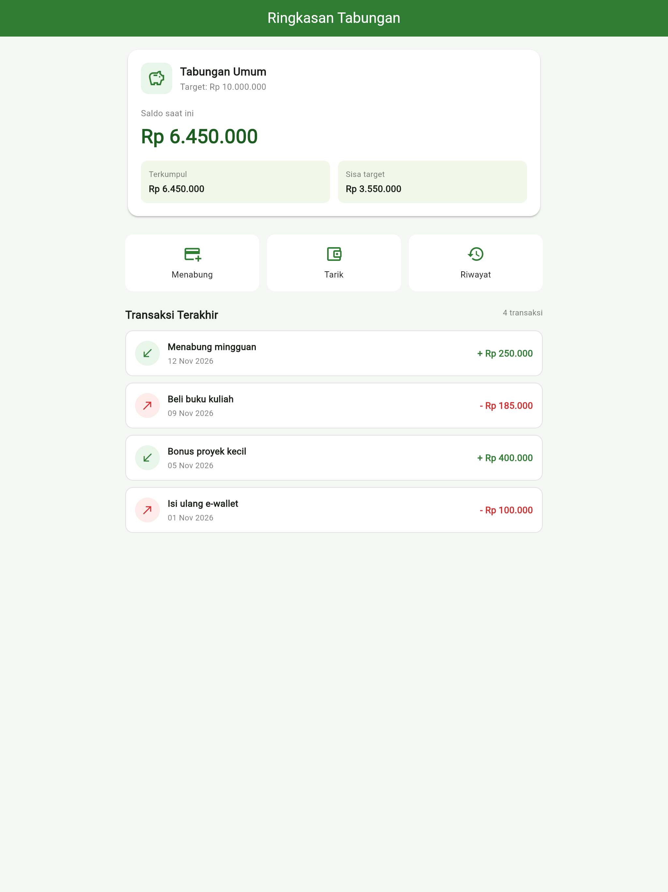

# TabungKu — Tugas Pertemuan 3

**Nama:** Saelendra Farell Syahbana
**NIM:** 20240801168
**Prodi:** Teknik Informatika
**Mata Kuliah:** TI505 Pemrograman Mobile

## Deskripsi

Aplikasi **TabungKu** menampilkan layar Ringkasan Tabungan yang berisi informasi saldo, target, tombol kategori, dan daftar transaksi. Tugas ini berfokus pada penyusunan layout menggunakan widget dasar Flutter tanpa paket pihak ketiga.

Data transaksi pada aplikasi ini masih ditulis langsung di dalam kode (statis) dan belum terhubung ke penyimpanan atau API.

## Bagian Tampilan

- **Kartu ringkasan**: nama tabungan, saldo saat ini, target, dana terkumpul, dan sisa target.
- **Baris kategori**: tiga tombol sejajar untuk Menabung, Tarik, dan Riwayat.
- **Daftar transaksi**: empat transaksi contoh dengan judul, tanggal, dan nominal. Nominal berwarna hijau untuk dana masuk dan merah untuk dana keluar.

## Widget Dasar yang Digunakan

`Scaffold`, `AppBar`, `SafeArea`, `ListView`, `Padding`, `Center`, `ConstrainedBox`, `Card`, `Container`, `Row`, `Column`, `Expanded`, `SizedBox`, `Text`, `Icon`, `Material`, dan `InkWell`.

`ListView` dipakai agar halaman tetap dapat digulir, sedangkan `ConstrainedBox` membatasi lebar konten supaya tampilan tetap nyaman dibaca di tablet.

## Struktur Proyek

```
tabungku/
├── lib/
│   └── main.dart
├── test/
│   └── widget_test.dart
├── docs/
│   ├── README.md
│   ├── screenshot_phone.png
│   └── screenshot_tablet.png
├── android/
├── web/
├── pubspec.yaml
└── README.md
```

## Cara Menjalankan

1. Pastikan Flutter SDK sudah terpasang (proyek ini dibuat dengan Flutter 3.24.3).
2. Masuk ke folder proyek:

   ```bash
   cd tabungku
   ```

3. Unduh dependensi:

   ```bash
   flutter pub get
   ```

4. Jalankan aplikasi pada emulator atau perangkat yang terhubung:

   ```bash
   flutter run
   ```

   Untuk melihat lewat browser:

   ```bash
   flutter run -d chrome
   ```

5. Menjalankan pengujian layout:

   ```bash
   flutter test
   ```

## Pengujian Layout

`test/widget_test.dart` menguji halaman pada dua ukuran layar:

- Ponsel: 390 × 844
- Tablet: 1024 × 1366

Pengujian memastikan seluruh bagian utama tampil dan tidak terjadi error overflow pada kedua ukuran tersebut.

## Tangkapan Layar

Tampilan ponsel:


Tampilan tablet:


